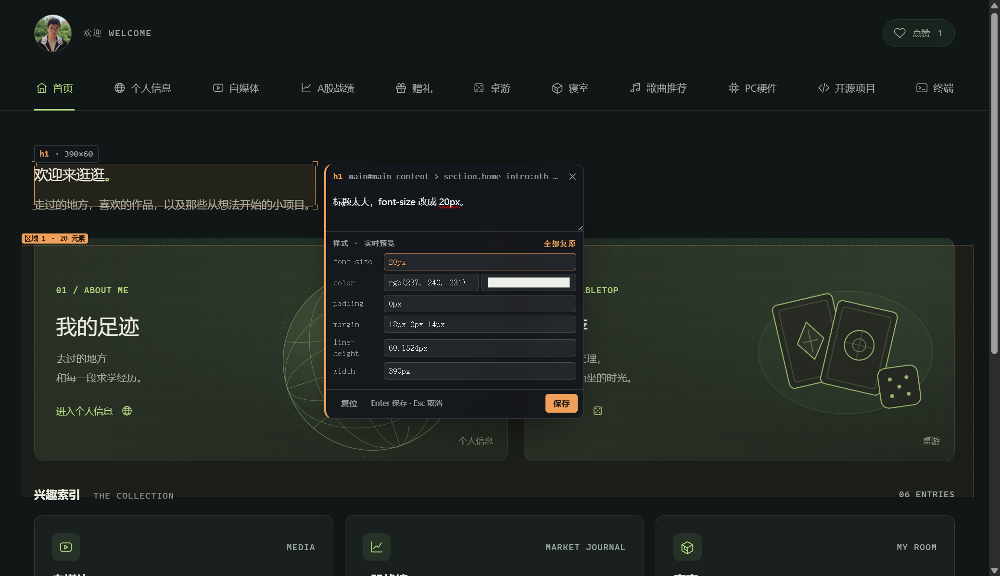

# dsh-lens

**Codex 风格的界面批注插件，给 DeepSeek Harness 用。** 打开当前工作区里正在跑的本地服务或静态页面，点元素、按住 Shift 框选区域、直接在页面上改样式实时预览，把修改意见一次性发进当前对话。

**Codex-style element annotation for DeepSeek Harness.** Open a local dev server or a static page from your workspace, click an element, Shift-drag a region, tweak styles with a live preview, and send the whole review into the current conversation in one message.



[中文](#中文) · [English](#english)

---

## 中文

### 它和 dsh-annotate 的区别

| | dsh-annotate 0.1.14 | dsh-lens |
| --- | --- | --- |
| 框选区域 | 只能点单个元素 | 按住 **Shift 点/拖**，框内元素全收进一条区域批注（容器标 `[容器]`，叶子带文本） |
| 样式面板 | 只能读计算样式 | 卡片里「⚙ 样式」展开，改 font-size / color / padding / margin / line-height / width，**页面当场变**，批注写 `from → to` |
| 快捷发送 | 存完再点发送 | **Ctrl+点击**元素 → 写（或不写）→ 回车，**立即发进当前对话**（只发这一条） |
| 挂载位置 | 只有右侧栏 | 右侧栏 tab + **对话区 View 标签**（`conversation.view`）+ 输入框上方 dock |
| 跨页批注 | 按页隔离 | 一个会话里**所有页面**的批注一起收集、分组展示、一次发送 |
| 服务发现 | 本机所有 loopback 端口 | 只列**当前工作区**自己起的服务（按进程命令行/可执行文件/声明端口认领），噪音不进门 |

交互对齐 [Codex 应用内浏览器文档](https://developers.openai.com/codex/app/browser)：点元素=选元素，**Shift 点/拖=框选区域**，**Ctrl+点=立即发送**，样式收在卡片齿轮里。

### 安装

这是一个本地插件，通过 `link:` 挂进 DSH profile，不需要发布到 npm。

```bash
git clone https://github.com/xulianglong-akk/dsh-lens.git
cd dsh-lens
node scripts/install.mjs          # 写入 link 依赖 + profile bundle 行，并备份 package.json
```

然后在 profile 目录里装一次（只建链接，不联网）：

```bash
cd "$DSH_HOME/profiles/desktop"   # Windows: %USERPROFILE%\.dsh\profiles\desktop
pnpm install
```

最后**完全退出并重开 DSH**（刷新页面不够：宿主半侧一个进程只加载一次）。

> 如果插件目录路径含非 ASCII 字符（例如中文目录），部分 DSH 版本在改写 profile manifest 时会把路径写坏。稳妥做法是先建一个纯 ASCII 的 junction 再安装：
> `mklink /J D:\dsh-lens-src "D:\你的目录\dsh-lens"`，然后 `node scripts/install.mjs --link D:/dsh-lens-src`。

卸载：`node scripts/rollback.mjs`（还原安装前的 `package.json`、删掉链接），然后重开 DSH。

### 使用

入口：右侧栏「批注」、对话区「批注」View 标签，或 `Ctrl+Shift+L`。

1. 面板只列**当前工作区**在跑的服务；认不出或服务不是从工作区起的，直接在底部输入 `4173` 这样的端口/地址即可（打开过的会记住）。打开页面后**自动进入圈选模式**。
2. 在页面里：
   - **点**元素 → 写批注 → `Enter` 保存，继续点下一个；`Esc` 退出圈选。
   - **按住 Shift 点/拖** → 框住一块 → 松手后列出「框内元素」→ 写批注 → `Enter`。
   - **按住 Ctrl 点** → 卡片变成「保存并发送」→ `Enter` 立即发这一条。
   - 卡片里 **⚙ 样式** → 改值 → 页面实时预览 → 保存时批注带 `font-size 42.966px → 20px`；「全部复原」撤回。
3. 顶部「列表」按**页面分组**显示这个会话收集到的所有批注：定位 / 标已处理 / 删除；「发送未处理 N」一次发完。
4. 点错了整页容器？卡片会提示「你点到的是整页容器」，改用 Shift 框选更准。

### 发出去的格式

```
🎯 界面标注 · 2 个页面 · 3 条

【http://127.0.0.1:5173/】
#1 h1
   选择器: main#main > header > h1（命中 1 个元素）
   位置/尺寸: 390×28 @ (47, 227) · 视口左上（17%W × 30%H）
   计算样式: display:block; width:390px; font-size:20px; color:rgb(237, 240, 231); …
   样式修改: font-size 42.966px → 20px
   文本: 欢迎来逛逛。
   批注: 标题太大，改 20px。

【http://127.0.0.1:5173/pricing】
#2 [框选区域] 1145×479 @ (143, 97)
   框内元素: 26 个（按 DOM 顺序）
     - section.grid [容器] @ 1016×319
     - article.card [容器] …
     - h2「面板 A · 大块，带嵌套」 @ 442×39
     …
   批注: 这三块卡片间距统一 24px。
```

每条都带：选择器 + 命中数、位置尺寸、视口方位、计算样式、可见文本、样式 from→to、批注正文。

### 为什么只列当前工作区的服务

本机跑着很多东西（各种客户端也占 loopback 端口）。dsh-lens 只把**能证明属于当前工作区**的服务列出来，证据三选一：

1. 监听进程的可执行文件在工作区里；
2. 命令行里出现工作区路径；
3. 命令行里的相对脚本（`node scripts/dev-server.mjs`）能在工作区里找到。

外加上「工作区自己声明的端口」（`--port`、`PORT || 4173`、vite `port:`）。一条都对不上就不列，手填地址即可。

### 已知限制

- **对话区 View 标签与 Chat 互斥**：`conversation.view` 的语义是「一次只渲染一个目标视图」，切到「批注」时 Chat 会收起，底部输入框还会压住一点面板。想看对话就切回「对话」，或用右侧栏。
- 区域框线按**文档坐标**记录，窗口滚动跟随；内层容器滚动时可能轻微漂移（元素 pin 不漂）。
- 样式预览是写元素内联样式；退出圈选时逐条还原，重新进入时按已保存批注再贴回去。
- 只代理 `127.0.0.1` / `localhost` / `[::1]`；HTTPS 本地服务原样转发，不忽略证书错误。
- Windows 的服务归属判定已实测；macOS/Linux 走 `/proc` + `ps` 分支，未在真机验证。
- 「Ctrl+点」之后仍要按一次 `Enter`（可以写批注，也可以空着）——省掉的是「再去点发送」。
- 一个面板挂一个预览 iframe；两个入口（侧栏 + 对话区）可以同时挂。
- 宿主半侧改动必须完全重开 DSH；`lib/overlay.js`、`lib/shim.js` 是每次回 HTML 重新读盘，刷新预览即生效。

### 目录

| 文件 | 作用 |
| --- | --- |
| `lib/index.js` | 宿主半侧：工作区范围的服务发现、loopback 预览代理、注入 shim/overlay、`POST /__dsh-lens/api` |
| `lib/client.js` | 客户端半侧：右侧栏 tab、`conversation.view`、header 按钮、输入框 dock、跨页批注列表与发送 |
| `lib/overlay.js` | 注入预览页的浮层：点选、Shift 框选、样式面板、Ctrl 点击、零残留 |
| `lib/shim.js` | 注入预览页的 URL/WS 映射与导航上报 |
| `scripts/install.mjs` / `scripts/rollback.mjs` | 一条命令安装 / 回滚 |
| `test/host-harness.mjs` | 不启动 DSH 的宿主半侧自测台（detect / preview） |
| `demo/` | 三页静态示例站，用来试框选和跨页批注 |

### 开发

```bash
node --check lib/index.js && node --check lib/client.js && node --check lib/overlay.js
node test/host-harness.mjs detect "D:/path/to/your/workspace"
node test/host-harness.mjs preview http://127.0.0.1:5173/ "D:/path/to/your/workspace"
```

---

## English

**Codex-style element annotation for DeepSeek Harness.** Open a local dev server or a static page from the current workspace, click elements, Shift-drag a region, tweak styles with a live preview, and send the whole review into the current conversation as one structured message.

### What it adds over dsh-annotate

- **Region selection** — hold **Shift** and click/drag; every element inside the box is collected into one region annotation (containers marked `[容器]`, leaf elements carry their text).
- **Live style panel** — the card's **⚙ styles** section edits font-size, color, padding, margin, line-height and width; the page updates immediately and the annotation records `from → to` values.
- **Instant send** — **Ctrl+click** an element, write a note (or leave it empty), press **Enter**: that one annotation is sent to the conversation right away.
- **Three seats** — the right sidebar tab, a `conversation.view` tab in the conversation area, and a dock above the composer.
- **Cross-page review** — annotations from every page of the session are collected, grouped by page, and sent together.
- **Workspace-scoped discovery** — only services that provably belong to the current workspace are listed (process executable, command line, or a declared port); other loopback ports stay out of the list.

The interaction follows the [Codex in-app browser documentation](https://developers.openai.com/codex/app/browser): click to select, **Shift+click/drag** for an area, **Cmd/Ctrl+click** to send immediately, and style controls folded into the comment card.

### Install

```bash
git clone https://github.com/xulianglong-akk/dsh-lens.git
cd dsh-lens
node scripts/install.mjs            # writes a link: dependency and the bundle row, backing up package.json
cd "$DSH_HOME/profiles/desktop"     # Windows: %USERPROFILE%\.dsh\profiles\desktop
pnpm install
```

Then **fully quit and reopen DSH** (a page refresh is not enough: the host half is loaded once per process).

If the checkout path contains non-ASCII characters, some DSH builds mangle the path while rewriting the profile manifest. Create an ASCII junction first and pass it explicitly:

```bat
mklink /J D:\dsh-lens-src "D:\your dir\dsh-lens"
node scripts/install.mjs --link D:/dsh-lens-src
```

Uninstall with `node scripts/rollback.mjs`, then restart DSH.

### Use

Open the sidebar tab **批注** (Annotation), the **批注** view tab in the conversation area, or press `Ctrl+Shift+L`.

1. Pick a workspace service, or type a port such as `4173`. The page opens **already in annotation mode**.
2. In the page:
   - **Click** an element, type a note, press `Enter`; keep clicking for the next one. `Esc` leaves annotation mode.
   - **Shift+click/drag** to box an area: the card lists every element inside it.
   - **Ctrl+click** to send that one annotation immediately (`Enter`).
   - **⚙ styles** in the card edits CSS with a live preview; values are recorded as `prop old → new`.
3. The **list** button groups the session's annotations by page: locate, mark done, delete, or send all open ones in one message.

### Output format

```
🎯 界面标注 · 2 pages · 3 annotations

【http://127.0.0.1:5173/】
#1 h1
   selector: main#main > header > h1 (matches: 1)
   position/size: 390×28 @ (47, 227) · viewport top-left (17%W × 30%H)
   computed: display:block; width:390px; font-size:20px; …
   style change: font-size 42.966px → 20px
   text: 欢迎来逛逛。
   note: 标题太大，改 20px。
```

### Limitations

- The `conversation.view` seat is exclusive with Chat by design (one target view renders at a time); the composer also overlaps its bottom edge. Use the right sidebar to see chat and preview side by side.
- Region outlines are stored in document coordinates; inner-container scrolling can drift them slightly (element pins do not drift).
- Style previews are inline styles, restored when annotation mode ends and re-applied from saved annotations when it starts again.
- Loopback targets only (`127.0.0.1`, `localhost`, `[::1]`); local HTTPS is proxied as-is without certificate bypass.
- Windows discovery is tested; the macOS/Linux `/proc` + `ps` branches are not.
- Ctrl+click still needs one `Enter` (a note is optional); what it removes is the separate Send click.
- Host-half changes require a full DSH restart; `lib/overlay.js` and `lib/shim.js` are re-read per HTML response, so a preview refresh is enough for those.

### License

MIT. The loopback preview proxy, the page shim and the annotation payload plumbing are derived from [dsh-annotate](https://github.com/alaliqing/dsh-annotate) by qinjing, also MIT — see `LICENSE`.
